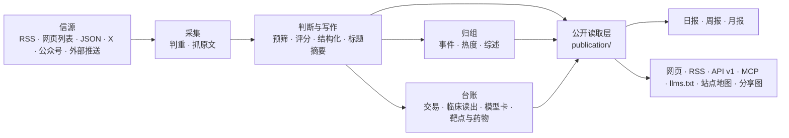

# 架构

白泽智药（AIDD，AI 药物研发）的代码分四块：跑起来的三个进程在 `apps/`，它们共用的业务代码和类型在 `packages/`，这个站自己的配置（站名、文案、模型、品牌）在 `site/`，行业知识（分类、信源、提示词、门槛）在 `industry/`。引擎不写死任何一站的值，只看这两处配置。



## 三个进程

| 进程 | 位置 | 做什么 |
|---|---|---|
| api | `apps/api/` | Fastify。网站自用接口（`/api/site/`）、公开 API（`/api/v1/`）、RSS、MCP、后台接口、图片代理（`/api/img-proxy`）、分享图（`/og/`） |
| worker | `apps/worker/` | pg-boss 任务队列和定时任务：抓信源、调模型、归组、热度、日报周报月报、告警、清理、备份 |
| web | `apps/web/` | React Router 服务端渲染的网页。只通过 HTTP 读 api，不碰数据库、不拿密钥 |

业务代码都在 `packages/backend/`，前后端共用的类型和常量在 `packages/contracts/`。后台接口以 `packages/contracts/src/admin.ts` 为准，任务载荷以 `jobs/queue.ts` 的 `JobData` 为准，公开接口的响应类型（含台账的行）在 `packages/contracts/src/site.ts`。

## 几条不变的规则

- **一个公开读取层**：网页、RSS、API、MCP、站点地图、分享图读的都是 `packages/backend/src/publication/`。公开范围、精选席位（机器出口每条新闻只出一条）与事实证据条件只在 `publication/scope.ts` 定义；新增出口也遵循当前的撤回和全文许可。已出刊报告保留当期写作，但引用是否可公开、来源名和引用时间仍按当前资料判断；撤回也要移除依赖该引用的导读与封面。
- **页面不调模型**：读者打开任何页面（含台账页和靶点/药物页）只读数据库里已经有的结果；模型只在 worker 的任务里调用。
- **缓存不延长旧内容的寿命**：可变内容按响应的 `Cache-Control` 到期重新验证，站点地图的进程、磁盘与 HTTP 缓存共用同一个截止时间，不能在发送时重新计时；MCP 的 HTTP 响应使用 `no-store`。自建代理或 CDN 同样要遵守，配置要求见 [部署](deploy.md#配域名和-https)。
- **花钱的请求有回执**：每个付费请求（模型、X、公众号、Jina）先记一张回执，拿到结果先存再用。进程重启、任务重试时，复用已经付过钱的结果，不重复花钱（`providers/receipts.ts`）。结果不明的回执超过 30 分钟后自动放行一次；因它停在失败状态的文章会重新入队，继续未完成的正文提取或分析。再次结果不明时，由管理员在“运行”页核对后放行。
- **预算熔断**：每个付费服务有每分钟、每小时、每天的上限，超过就暂停（后台“设置 → 付费请求上限”）。
- **安全阀**：`COLLECT_ENABLED`、`MODEL_CALLS_ENABLED`、`FEISHU_CONTENT_PUSH_ENABLED`、`DINGTALK_CONTENT_PUSH_ENABLED`、`FEISHU_INTERNAL_ENABLED`、`INDEXNOW_SUBMIT_ENABLED`、`BAIDU_PUSH_ENABLED` 只决定“发不发出去”，不决定走哪套逻辑；只有设成 `true` 才打开，写 `1`、`yes` 都算关。`scripts/init-env.ts` 生成的 `.env` 会打开采集和模型调用，只调界面时可以改成 `false`；测试里推送一直关着，采集和模型调用只连本地假服务。
- **公开内容匿名**：管理员和访客看到的一样；读者的收藏、已读存在浏览器里。后台只允许管理员。
- **旧文不刷屏**：发现时已发布超过 48 小时的资料（`content/materials.ts` 的 `STALE_ON_DISCOVERY_MS`）、新信源第一次导入的存量、回灌的推送，按原文时间归档，不进“今天”、不推送；第一次导入之后不再收列表里更早的存量。没有可信发布时间的资料先不公开，读到日期后再判断新旧。
- **来源可追溯**：每条精选都链接原文；站内是否显示全文由信源的 `site_fulltext` 决定，默认只显示摘要。
- **规则由所属模块维护**：后台调用内容、事件、通知与恢复模块，不直接改写它们的状态；业务模块不反过来依赖后台。人工修改、公开结果与恢复所需记录一起提交。

这些模块边界由 `tests/architecture.test.ts` 检查；调整边界时同时更新约定与检查。站点身份和每一步的模型从 `site/` 读，行业分类和提示词从 `industry/` 读，代码里不写死某个站的值。

## 台账：交易、临床读出、模型卡

本站比一般的资讯站多一层：把每条精选里“能对得上号”的事实抽成结构化卡片，攒成三张可以按字段筛选的台账，再从卡片里长出靶点和药物页。链路是 抽取 → 存 → 读 → 出页，中间没有第二份判断。

| 环节 | 位置 | 做什么 |
|---|---|---|
| 抽取 | `industry/prompts/structure.md` | 结构抽取那一步除分类、标签、主体公司外，还输出 `deal` / `readout` / `modelCard` 三个可空对象，写在 `analyses.output` 的 jsonb 里 |
| 读表 | `packages/backend/src/publication/structured.ts` | `loadTable(kind, query)` 读出 `/deals`、`/readouts`、`/model-cards` 三张台账 |
| 实体页 | `packages/backend/src/publication/entities.ts` | 从读出卡里的 `target` / `drug` 长出 `/targets`、`/drugs` 和每个实体的页面 |
| 报告 | `packages/backend/src/reports/ledger.ts` | 给周报、月报的内容 JSON 加一段“台账”：笔数、已披露金额、阳性与阴性条数、开源权重条数 |
| 出口 | `apps/api/src/routes/{v1,site}.ts` | `/api/v1/tables/{kind}` 与 `/api/site/tables/{kind}`，`kind` 只取 `deals`、`readouts`、`models` |

三张卡的字段（完整定义在 `packages/contracts/src/site.ts`）：

- `deal`：`kind`（license / acquisition / collaboration / financing / ipo / other）、`parties`、`asset`、`modality`、`phase`、`upfrontUsd`、`totalUsd`、`amountText`。
- `readout`：`drug`、`target`、`modality`、`phase`、`indication`、`endpoints`（名称、数值、单位、p 值）、`n`、`result`（positive / negative / mixed / neutral）、`trialId`。
- `modelCard`：`name`、`version`、`task`、`modality`、`benchmarks`、`weights`（open / restricted / closed / unknown）、`license`。

几条由此而来的约定：

- **卡片是注记，不是判断**。行只在那一步从材料本身写出卡片时存在；表格的可见范围与“全部动态”相同（`browsedCondition`），综合稿（`scope = composite`）不进表。卡片随 analysis 带出（`p.analysis_id`），所以撤回一条精选，它的卡片一起消失。
- **只写原文里查得到的数字**。提示词禁止估算、换算、补全：“约 5 亿美元”“据传”后面的数字留空，人民币或没写币种的金额不换算，`totalUsd` 留空。台账页的金额列因此可能为空，这是设计，不是缺数据。
- **筛选只认卡里已有的值**：`deals` 按 `kind`、`readouts` 按 `result`、`models` 按 `weights`，其余字段不做范围查询。
- **靶点页与药物页由读出卡点名才有**：同一件事的不同写法先过别名表 `industry/aliases.json`（按字母数字归一后比整串、括号前的主体、括号里的每个名字，所以 `KRAS G12C`、`KRAS(G12C)`、`KRAS G12C 突变` 是一页，而 `KRAS G12C` 不会被 `KRAS` 吞掉）；没列进别名表的按字母互相包含自动归并，最长的写法当页名和 slug。只有被已收录的读出点过名的名字才建页，单独一笔 license-out 交易不建页；同一目标下的交易按 `asset` / `modality` 的文本提及挂进该页。
- **报告里的台账只数不写**：`reports/ledger.ts` 只读库、不调模型，数出交易笔数与已披露总额（`totalUsd` 或 `upfrontUsd`）、读出阳性/阴性/混合各几条、模型开源/受限/闭源各几项，各列最多 4 行。台账为空时这段不出现。

要动这套东西，得同时改这几处：抽取规则在 `industry/prompts/structure.md`，类型在 `packages/contracts/src/site.ts`，读法在 `publication/structured.ts`，实体归并在 `industry/aliases.json` 与 `publication/entities.ts`，报告在 `reports/ledger.ts`，页面在 `apps/web/app/features/tables/`，出口在 `apps/api/src/routes/{v1,site}.ts` 与 `publication/sitemap.ts`。少改一处，页面和 API 就会对不上。

## 目录

| 位置 | 内容 |
|---|---|
| `site/` | 这个站自己的：站名文案（`site.ts`）、每一步的模型（`models.ts`）、品牌与 Logo（`brand/`）、条款页（`pages/`）、网站根目录的固定文件（`public/`）、更新日志，以及启用哪些模块（`modules/`） |
| `industry/` | 行业包：分类标签与词表（`taxonomy.ts`）、主题（`topics.json`）、信源清单（`sources.json`）、靶点与药物别名（`aliases.json`）、提示词（`prompts/`）、门槛（`selection.ts`）、校准样本（`gold.jsonl`） |
| `packages/backend/src/sources/` | 信源读取器（RSS、网页列表、JSON、X、公众号、外部推送），抓取调度在 `collect.ts` |
| `packages/backend/src/content/` | 资料入库、判重、正文提取、清洗与时间判定 |
| `packages/backend/src/editorial/` | 判断与写作：`analyze.ts`（流程）、`prompts.ts`（读提示词）、`models.ts`（每一步用哪个模型） |
| `packages/backend/src/events/` | 事件归组、热度、事件综述 |
| `packages/backend/src/publication/` | 公开读取层：范围、详情、列表、台账、实体页、RSS、MCP、站点地图、分享图 |
| `packages/backend/src/reports/` | 日报、周报、月报，含台账段（`ledger.ts`） |
| `packages/backend/src/providers/` | 模型、向量、X、公众号、Jina 的调用，回执与预算 |
| `packages/backend/src/notify/` | 飞书、钉钉推送 |
| `packages/backend/src/operations/` | 告警、备份、清理、IndexNow、百度推送 |
| `packages/backend/src/admin/` | 后台接口 |
| `apps/web/app/routes/` | 每个页面一个文件，路由表在 `apps/web/app/routes.ts` |
| `database/migrations/` | 数据库迁移，按完整文件名排序执行和记账 |
| `scripts/` | 初始化、迁移、种子数据、评测、检查脚本 |
| `tests/` | 后端测试（数据库名必须以 `_test` 或 `_ci` 结尾，见下文） |

## 模块

框架里没有、只有这个站要的功能（比如一个专门的靶点专题页或监控榜），做成模块：一个功能一个文件夹 `modules/<名字>/`，是一个名为 `@aihot/<名字>` 的 npm 包，装着它自己的后端、接口、页面、样式、数据库迁移和测试。本站目前没有模块（`site/modules/index.ts` 是空数组），需要的功能先看能不能用台账和主题页解决。

| 文件 | 内容 |
|---|---|
| `module.ts` | 它的地址：页面、跳转、交给 api 处理的路径（类型见 `packages/contracts/src/modules.ts`） |
| `server.ts` | 它接进后端的插口：接口、定时任务、队列、事件回调、后台页面的数据等（`packages/backend/src/modules.ts`，每个插口注明读它的文件） |
| `web.tsx` | 它接进网页的插口：页面、导航项、主题页与后台的部件等（`apps/web/app/modules.ts`）；只在某一页出现的部件给出加载函数，随那一页的代码加载 |
| `migrations/`、`tests/` | 它自己的表与测试，和引擎的一起按文件名排序执行、一起跑 |

写好以后在 `site/modules/` 的三份清单里列上它：`index.ts` 列地址，`server.ts` 列后端，`web.ts` 列网页，没有的那份不列；再在 `site/package.json` 的 `dependencies` 里写上它。模块通过 `agent.abilities` 提供 MCP 工具，`scripts/mcp-check.ts` 检查完整工具集合。框架的代码不导入任何模块，只读这三份清单，所以合并框架的更新时不容易和自己的功能冲突。

## 数据库迁移

已经发布的迁移是部署历史，不能改写或删除；修正放进新的文件。按完整文件名排序执行并记录是否执行；编号相同的不同文件分别执行，同一完整文件名不能出现在两个目录中。从 `0055` 起，每个文件只放一条允许在线执行的语句，PR 会拒绝不符合约定的新增迁移，也不允许用较小编号绕过检查。

新增列优先使用可空列或常量默认值；给已有表加 CHECK、外键时先 `NOT VALID`，再用另一个迁移验证。索引使用单独的 `CREATE INDEX CONCURRENTLY IF NOT EXISTS`；不能在发布迁移里做大批 UPDATE、DELETE 或用 DO 隐藏它们。改类型、删列等破坏性变更单独设计升级与回退步骤，在 [部署文档](deploy.md#更新) 写明对已有数据的影响。

## 对外出口

事件 `related` 关联建立时须有至少两篇报道支撑，证据不足就不公开展示；报道自然超出召回窗口、沿用归属的普通修订不使关联过期。所有公开出口共用这套读取规则。

| 地址 | 内容 |
|---|---|
| `/` `/all` `/hot` `/topics` `/daily` `/weekly` `/monthly` | 精选、全部动态、热门事件、主题、日报周报月报 |
| `/deals` `/readouts` `/model-cards` | 三张台账：交易、临床读出、模型卡 |
| `/targets` `/drugs`（含 `/<slug>`） | 靶点与药物实体页，只收被已收录读出点过名的名字 |
| `/feed.xml` `/feed/full.xml` `/feed/all.xml` `/feed/daily.xml` `/feed/weekly.xml` `/feed/monthly.xml` | RSS：精选、精选全文、全部、日报、周报、月报；另有 `/feed/category/<key>.xml` 与 `/feed/full/category/<key>.xml` |
| `/api/v1/` | 公开 API，文档在 `/openapi-v1.json`；台账在 `/api/v1/tables/{kind}`；给 Agent 读的 Markdown 从 `/api/v1/agent` 开始，说明页在 `/agent` |
| `/api/mcp` | MCP 服务：最新、搜索、热点、事件、日报、周报、月报各一个工具，工具名前缀是 `site/site.ts` 的 `mcpPrefix`（`baize`） |
| `/llms.txt` `/sitemap.xml` `/robots.txt` | 给大模型和搜索引擎的说明（根目录固定文件在 `site/public/`）；站点地图收三张台账页与实体页 |
| `/admin` | 后台 |

## 测试

```bash
npm run typecheck
DATABASE_URL=postgres://127.0.0.1:5432/baize_test npm test
npm run build -w @aihot/web && npm run test:web
```

`DATABASE_URL` 指向的库名必须以 `_test` 或 `_ci` 结尾；没有会自动创建并迁移。每个测试文件在它的一份副本上并行运行，所以数据库账号要有建库权限（`CREATEDB`）。测试不访问任何外部服务：模型和付费接口都由本地假服务回答。
